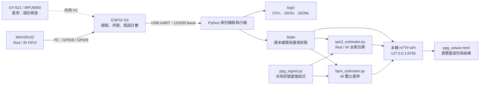

# Wrist PPG：ESP32-S3 光學脈搏監測

使用 **ESP32-S3-DevKitC-1 + MAX30102** 擷取 Red／IR 原始 PPG，
經 USB 傳到電腦，在本機網頁顯示波形、資料率、獨立 BPM 與 30 秒實驗血氧估算。
GY-521（MPU6050）可接在同一條 I²C 匯流排，目前用於識別與通訊檢查。

本專案目前是「感測器＋開發板＋電腦」的原型。BPM 與 SpO₂ 都在電腦端計算，
顯示於瀏覽器。尚未加入 OLED、IMU 動作補償、自適應 LED 控制或專案自訂 RTOS 任務。

> BPM 是 PPG 脈率估值，尚未與 ECG／參考心率儀同步驗證；SpO₂ 使用未針對
> 此模組校正的參考曲線。兩者供開發與實驗使用，不能用來作醫療判斷。

## 功能概覽

| 功能 | 目前行為 |
|---|---|
| 原始波形 | 同時顯示 Red／IR 的 18-bit ADC 原始碼，保留 DC，縱軸自動縮放 |
| 資料率 | 感測器設定為每通道 100 Hz；畫面另外計算實收資料率，不以設定值冒充實測值 |
| 傳輸檢查 | 追蹤 I²C 錯誤、FIFO 溢位、遺失樣本下限、序號缺漏與外光溢位事件 |
| 即時 BPM | 只分析 IR，使用最近約 10 秒資料、每秒更新，不依賴血氧 R 或 Red 品質 |
| 30 秒記錄 | 可保存原始腕部記錄；完成後另計算獨立 BPM 摘要 |
| 實驗 SpO₂ | 接觸穩定檢查通過後，記錄完整 30 秒；分開顯示波形品質與換算資格 |
| 本機保存 | 自動保存 CSV、序列紀錄、BPM 分析紀錄及量測結果 JSON |

## 程式架構



ESP32 只傳原始樣本與裝置狀態。Python 的串列讀取執行緒負責接收、記錄與觸發分析；
HTTP 服務提供狀態，前端每 200 ms 輪詢並用 Canvas 繪圖。
瀏覽器沒有負責讀取序列埠，因此關閉分頁不會停止背景擷取。
服務只綁定 `127.0.0.1`，不需要雲端帳號、API Key、Node.js 前端建置或資料庫。

### 主要檔案

```text
wrist-ppg-embedded/
├── platformio.ini                 開發板、框架、來源目錄與串列設定
├── firmware/
│   ├── include/board_config.h      腳位、I²C 位址與 MAX30102 設定
│   ├── include/ppg_stream.h        原始串流介面
│   ├── src/main.cpp               啟動、s/v/p/x 序列命令與識別檢查
│   └── src/ppg_stream.cpp         MAX30102 設定、FIFO 讀取與錯誤處理
├── tools/
│   ├── requirements.txt           顯示服務的 Python 依賴：pyserial
│   ├── ppg_viewer.py              串列接收、量測狀態、檔案記錄與 HTTP API
│   ├── ppg_viewer.html            網頁介面、Canvas 波形與按鈕
│   ├── ppg_signal.py              濾波、局部基線、週期性與雜訊分析
│   ├── bpm_estimator.py           獨立 IR 脈率與 30 秒脈率摘要
│   ├── spo2_estimator.py          血氧波形品質、R 與參考曲線換算
│   ├── start_ppg_viewer.ps1        使用 PlatformIO Python 的啟動捷徑
│   ├── diagnose_spo2.py           舊量測的離線診斷工具
│   └── verify_*.py                依賴歷史量測檔的回放工具
└── tests/
    ├── test_ppg_viewer.py         記錄與傳輸檢查
    ├── test_spo2.py               血氧估算與準備流程
    ├── test_bpm.py                脈率、獨立性與過期清除
    └── test_ppg_viewer_ui.js       前端狀態與顯示測試
```

韌體來源目錄是 **`firmware/src/`**，已在 `platformio.ini` 指定。
`logs/` 由程式執行時建立；既有量測資料與其他文件未放入此 repository。

## 硬體與接線

需要 ESP32-S3-DevKitC-1、MAX30102 模組、支援資料傳輸的 USB 線、跳線與固定感測器的材料。
GY-521 為選用：目前 PPG 擷取不依賴 IMU；若未接 IMU，雙模組識別檢查的整體結果不會是 PASS。

先拔掉 USB 再接線。下表是本專案使用的 3.3 V 接法：
**MAX30102 模組須明確支援 3.3 V VIN 與相容的 I²C 邏輯電位**；
僅有 `VIN` 字樣不足以確認供電規格，也不能將模組 VIN 視為裸晶片 VDD。

| ESP32-S3 | MAX30102 模組 | GY-521／MPU6050（選用） |
|---|---|---|
| 3V3 | VIN，確認模組規格後接入 | VCC，確認模組規格後接入 |
| GND | GND | GND、AD0 |
| GPIO8（板上標示 8） | SDA | SDA |
| GPIO9（板上標示 9） | SCL | SCL |

兩塊模組共地，SDA 接同一個節點，SCL 接另一個節點；GPIO 編號不是排針的第幾支。
MAX30102 位址為 `0x57`；MPU6050 的 AD0 接地時使用 `0x68`。
目前不使用 MAX30102 INT 或 GY-521 的 INT、XDA、XCL；GPIO6／GPIO7 只是程式中的預留腳位。

接好後使用開發板的 **COM／USB-to-UART 插座**。本版的 Upload 與串流走 UART，
請依板上標示辨認，不要假設兩個 USB 插座可直接互換。

## 從零架設：Windows / PowerShell

以下命令都在專案根目錄執行。`COM6` 是示例，請換成自己的連接埠。

### 1. 安裝工具並下載專案

安裝 Git、VS Code，以及 VS Code 的官方 **PlatformIO IDE** 擴充套件，
等待 PlatformIO 初始化完成。該擴充套件內建 PlatformIO Core，
不必另外安裝 Arduino IDE 或 MAX30102 Arduino 函式庫。
安裝入口與步驟見 [PlatformIO 官方指南](https://docs.platformio.org/en/latest/integration/ide/vscode.html#installation)。

```powershell
git clone https://github.com/clare8151214/wrist-ppg-embedded.git
cd wrist-ppg-embedded
```

在 VS Code 用「開啟資料夾」選取這一層，確認能看到 `platformio.ini`。
本專案驗證環境為 Python 3.11.7、PlatformIO Core 6.2.0；
Espressif32 平台版本由 `platformio.ini` 固定為 `7.1.3`。

### 2. 建立 Python 環境

以下使用 PlatformIO 在 Windows 的預設 Python 路徑。
若曾自訂 PlatformIO Core Directory，請將 `$PioPython` 改成該環境的 `python.exe` 路徑。

```powershell
$PioPython = Join-Path $env:USERPROFILE '.platformio\penv\Scripts\python.exe'
& $PioPython --version
& $PioPython -m venv .venv
$PpgPython = Join-Path $PWD '.venv\Scripts\python.exe'
& $PpgPython -m pip install -r tools\requirements.txt
```

這裡直接使用虛擬環境的 Python，不需要執行 `Activate.ps1`，也不需要更改 PowerShell 執行原則。
這種用法由 [Python venv 文件](https://docs.python.org/3/library/venv.html)支援。
即時顯示只需要 `pyserial`；BPM／SpO₂ 計算使用 Python 標準函式庫。

### 3. 找連接埠、Build、Upload

接上 ESP32 的 COM USB，列出連接埠：

```powershell
& $PpgPython -m serial.tools.list_ports -v
```

可依拔插前後的差異確認哪個埠是開發板；列舉指令見
[pySerial 官方文件](https://pyserial.readthedocs.io/en/latest/tools.html#serial-tools-list-ports)。
選好後執行：

```powershell
$BoardPort = 'COM6'
& $PioPython -m platformio run
& $PioPython -m platformio run --target upload --upload-port $BoardPort
```

第一次 Build 會下載工具鏈，需網路連線。也可使用 VS Code 的 PlatformIO Build／Upload 按鈕。
**Upload、Serial Monitor、顯示服務只能由其中一個佔用同一個 COM 埠**；
上傳前先結束舊顯示服務，上傳完成後再啟動。

### 4. 啟動電腦顯示

```powershell
& $PpgPython tools\ppg_viewer.py --port $BoardPort --open
```

服務會自動傳送 `p` 啟動感測器串流，並開啟
[http://127.0.0.1:8765](http://127.0.0.1:8765)。
若瀏覽器沒有自動開啟，手動輸入這個網址。

重新開啟 PowerShell 後，前面的變數不會保留；在專案根目錄可直接使用：

```powershell
& .\.venv\Scripts\python.exe tools\ppg_viewer.py --port COM6 --open
```

若要使用其他 HTTP 埠：

```powershell
& .\.venv\Scripts\python.exe tools\ppg_viewer.py --port COM6 --http-port 8766 --open
```

此時網址是 `http://127.0.0.1:8766`。命令列選項可用 `--help` 查看。
目前實機驗證平台是 Windows；macOS／Linux 需另處理 Python 環境、序列埠名稱與存取權限。

## 如何操作

### 看波形與 BPM

1. 確認頁面顯示「串流中」，Red／IR 波形持續更新、資料率接近每通道 100 Hz。
2. 將光學窗穩定貼合指腹或手腕內側，遮住外光，手臂靠桌保持不動；避免用力壓迫或拉扯接線。
3. 約 10 秒資料後，獨立 BPM 開始每秒判定。只有 IR 品質通過時才顯示數值。
4. 若顯示「—」，查看拒絕原因，調整接觸後等待新的分析窗。

BPM 方法為 `ir_interval_bpm_v1`：用 IR 脈搏間隔，配合週期性、雜訊、漂移與間隔一致性檢查，
目前報告範圍為 40～180 BPM。Red 不良或血氧 R 不合格不會單獨阻止 BPM。
傳輸故障、IR 品質不合格、停止或資料過期時會清除即時舊值。

### 保存 30 秒原始資料

將感測器固定於手腕後按 **「30 秒原始腕部記錄」**，保持不動直到記錄結束。
這個操作檢查資料率與傳輸完整性，完成後附上獨立 BPM 摘要；
摘要使用三個 10 秒區段，至少兩段合格且一致性通過才顯示。
介面會將這個歷史摘要標成「非即時」。

### 做 30 秒實驗 SpO₂ 換算

選擇實際測量位置，按 **「檢查穩定度並記錄 30 秒」**。
先收集六秒波形，每秒檢查，連續三次通過才開始正式 30 秒記錄。
準備最多 30 秒；若超時則報告原因，不把準備資料當成完成的量測。

SpO₂ 方法為 `continuous_acdc_reference_curve_v3`，以 Red／IR 的 AC/DC 比值求 R，
目前 R 換算範圍為 **0.3～1.84**，並另檢查波形及區段一致性。
結果會分別顯示「波形品質」與「換算資格」；任一必要條件未通過就不輸出百分比。
R 下限不是將 R 固定成 0.3。顯示一位小數也不代表已達到相同精度。

### 停止與關閉

- **停止擷取**：停止感測器並關閉 LED，取消進行中的記錄；HTTP 服務仍開著。
- **重新擷取**：重新開始串流與累積 BPM 資料。
- **關閉服務並釋放連接埠**，或終端機 `Ctrl+C`：停止服務並釋放 COM。
- 只關閉瀏覽器分頁，背景程式仍會繼續記錄。

## 資料保存與 API

每次啟動建立一個 `logs/ppg-日期-時間/` 資料夾，絕對路徑會顯示於終端機及網頁底部。

| 檔案 | 內容 |
|---|---|
| `session.json` | 埠號、擷取設定、BPM／SpO₂ 版本與門檻 |
| `serial.log` | 收到的原始序列資料與狀態文字 |
| `raw.csv` | 整段服務期間收到的 Red／IR 原始樣本 |
| `bpm-live.jsonl` | 每秒 BPM 分析結果；無效時保留拒絕原因 |
| `wrist-*.csv`、`spo2-*.csv` | 單次記錄的原始資料；準備超時可能是空的正式記錄 |
| 同名 `.json`、`latest-measurement.json` | 單次量測檢查、BPM 摘要與可選的 SpO₂ 結果 |
| `summary.json` | 服務正常結束時的最後狀態 |

原始 CSV 欄位：

```text
host_elapsed_s,session,seq,read_elapsed_us,red_raw,ir_raw
```

`host_elapsed_s` 是電腦接收時間；`read_elapsed_us` 是裝置 FIFO 讀取完成時間，
不是精確的 ADC 轉換時間。`red_raw`／`ir_raw` 單位是原始 ADC 碼。
序列中的 `D,...` 為樣本、`M,...` 為裝置計數、`# ...` 為狀態訊息。

| API | 用途 |
|---|---|
| `GET /api/state` | 原始波形、資料率、錯誤、即時 BPM 與量測狀態 |
| `GET /api/bpm` | 獨立即時 BPM；無效時 `valid=false`、`bpm=null` |
| `GET /api/latest-result` | 最新量測結果 JSON；尚無結果時回傳 404 |
| `GET /api/latest.csv` | 最新量測的原始 CSV |
| `POST /api/start`、`POST /api/stop` | 啟動／停止擷取 |
| `POST /api/measure/wrist`、`POST /api/measure/bench` | 30 秒原始記錄；bench 由 API 啟動 |
| `POST /api/measure/spo2/finger`、`POST /api/measure/spo2/wrist` | 血氧準備與記錄流程 |
| `POST /api/shutdown` | 停止服務並釋放序列埠 |

例如，讀取目前的 BPM 狀態：

```powershell
Invoke-RestMethod http://127.0.0.1:8765/api/bpm
```

## 測試與開發

以下軟體測試不需要接開發板，也不依賴未公開的歷史量測：

```powershell
& .\.venv\Scripts\python.exe -m unittest discover -s tests -v
```

若要跑介面狀態測試，另準備可執行 `node` 的 Node.js 環境；不需 `npm install`：

```powershell
node tests\test_ppg_viewer_ui.js
```

2026-11-17 已通過 37 項 Python 測試、介面測試及 PlatformIO Build。
測試涵蓋合成脈率、BPM／SpO₂ 獨立性、雜訊拒絕、掉樣與過期清除，
不代表已完成真實人體量測的準確度驗證。

`tools/diagnose_spo2.py`、`tools/verify_*.py` 是針對特定舊資料的診斷／回放工具，
依賴未上傳的 `logs/` 資料及封存版本，**新 clone 不能直接重現這些歷史回放**。
`diagnose_spo2.py` 另需 NumPy／Matplotlib；`verify_spo2_v2.py` 只適用封存的 v2 算法。
一般啟動與上面的單元測試不需要它們。

修改腳位／LED／擷取設定請看 `firmware/include/board_config.h`，修改後重新 Build、Upload。
修改 Python／HTML 後重新啟動顯示服務並重新整理頁面即可。
品質門檻分別在 `bpm_estimator.py` 與 `spo2_estimator.py`；調整時應記錄算法版本並驗證拒絕案例。

## 常見問題

| 現象 | 檢查方式 |
|---|---|
| 找不到 COM 埠 | 確認使用 COM 插座及資料 USB 線；查看裝置管理員，依 USB-UART 晶片安裝對應驅動 |
| `Access is denied`／埠被佔用 | 關閉 Serial Monitor 或舊 viewer；由舊頁面的關閉服務按鈕釋放 COM，再啟動 |
| `No module named serial` | 用啟動 viewer 的同一個 Python 執行 `-m pip install -r tools\requirements.txt` |
| 找不到 `$PioPython` 指向的執行檔 | 等待 PlatformIO 初始化完成；若使用自訂 Core Directory，調整變數路徑 |
| `Activate.ps1` 被阻擋 | 直接使用本 README 的 `.venv\Scripts\python.exe` 命令，不需要啟用腳本 |
| HTTP 埠被使用／WinError 10048 | 先關閉舊服務；也可用 `--http-port 8766`，但同一 COM 仍只能由一個服務使用 |
| `BUS_NOT_IDLE`／找不到 `0x57` | 拔掉 USB 後核對模組供電、共地、SDA→8、SCL→9，以及麵包板實際連通位置 |
| 服務有開但沒有樣本 | 確認韌體已上傳、接對 COM；看狀態訊息，修正後按「重新擷取」 |
| BPM 或 SpO₂ 顯示「—」 | 看拒絕原因，固定感測器、改善遮光並重新累積資料；不要將舊值當成本次結果 |
| 血氧失敗但 BPM 有數字 | 兩者判定獨立；BPM 只需 IR 脈搏，血氧還需要 Red、R 與跨區段一致性 |

要單獨診斷 I²C，先關閉 viewer，再開 115200 baud Serial Monitor：

```powershell
& $PioPython -m platformio device monitor --port COM6 --baud 115200
```

傳送 `s` 探測 `0x57`／`0x68`／`0x69`；`v` 重複檢查識別暫存器；
`p` 開始原始串流；`x` 停止並關閉 LED。`s`／`v` 會先停止串流。
ACK 只代表該位址有回應，仍需看識別檢查與實際資料；完成後關閉 Monitor，才能重新開 viewer。
